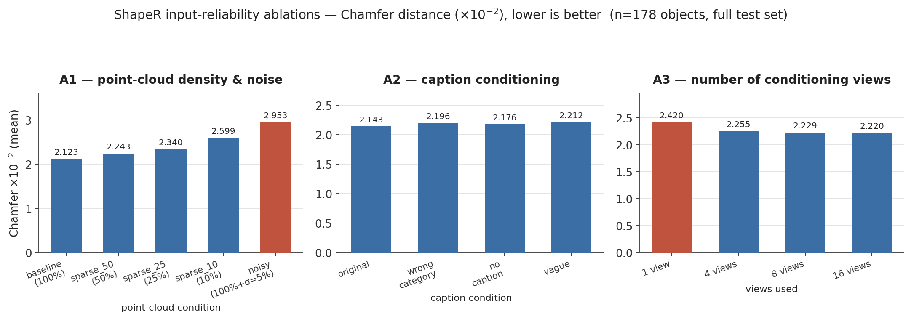
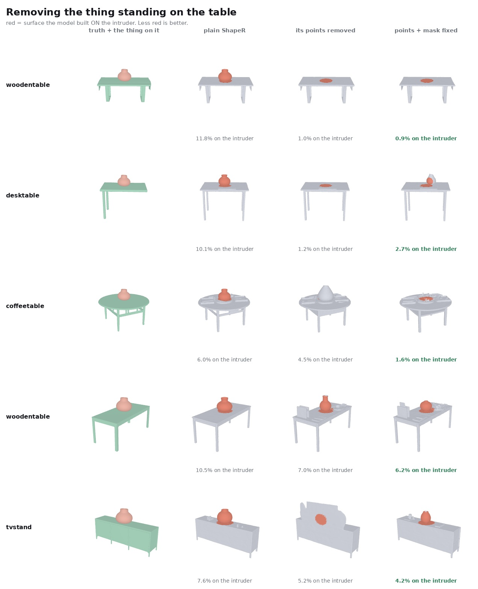

# Robust Object Reconstruction under Sparse Observations, Occlusion, and Clutter

**Status: ongoing thesis research.** Part of *"Towards Object-Centric 3D Scene Understanding for
Robotic Manipulation."* This is an **experimental study built on top of ShapeR and SAM2** — it
evaluates, conditions, and probes those released models; it does not claim to have developed
either of them. See [NOTICE.md](NOTICE.md) for full attribution.

**Research question:** how do input reliability and target conditioning affect object-level 3D
reconstruction?

---

*Real output, not a mockup — off-guidance, SAM2-guided, and depth-verified-oracle-guided
reconstructions on the same cluttered input, with measured Leak% per panel. The headline finding
of this repository is visible right here: even a **perfect** mask barely moves the number. See
[D](docs/D-depth-verified-masks.md).*

## What this repository actually contains

Four independent ablation/probe studies run against released ShapeR inference, one of which adds
a small (305-parameter) trained conditioning module on top of a frozen ShapeR checkpoint:

| | modification vs upstream | retrains anything? |
|---|---|---|
| **A** — input ablations | none — inference-time perturbation of inputs only | no |
| **B** — SAM2 mask conditioning | widened conv + 1 learned scalar, 305 params, backbone frozen | yes (305 params, ~22 min) |
| **C** — occlusion & clutter | synthetic data injection + a latent-space clutter-suppression method | no (method is training-free) |
| **D** — depth-verified masks | a verification/filtering step built around the same frozen models | no |

Everything else — ShapeR's architecture, checkpoints, and SAM2's weights — is used exactly as
released. The full list of what is and isn't original to this work is in
[NOTICE.md](NOTICE.md).

## Experiment index

| section | question | key result | docs |
|---|---|---|---|
| **A** | Does sparse/noisy point data, bad captions, or few views break reconstruction? | Positional noise hurts more than losing 90% of points; captions barely matter; 4 views captures most of the view-count gain | [A-input-ablations.md](docs/A-input-ablations.md) |
| **B** | Does a lightweight SAM2-mask-conditioned fine-tune reduce non-target geometry? | No — null on a pre-registered 30-cell multi-seed test | [B-mask-conditioning.md](docs/B-mask-conditioning.md) |
| **C** | Does ShapeR leak neighbouring-object geometry under clutter, and can it be suppressed? | Yes, dose-dependent and object-dependent; a training-free latent-suppression method (`refeed`) removes it on affected objects at near-zero cost, but **does not generalise** past its original 5-object set | [C-occlusion-and-clutter.md](docs/C-occlusion-and-clutter.md) |
| **D** | Is leakage caused by mask *inaccuracy*, or something deeper? | Neither a perfect depth-verified mask nor a support-segmenter fix meaningfully helps — the conditioning channel itself is the bottleneck | [D-depth-verified-masks.md](docs/D-depth-verified-masks.md) |

Supporting pages: [provenance.md](docs/provenance.md) (every number traced to its source file),
[setup-and-reproduction.md](docs/setup-and-reproduction.md), and
[limitations-and-future-work.md](docs/limitations-and-future-work.md).

## Selected quantitative findings

- **A** (n=178, full test set): noisy point cloud → Chamfer 0.0295 vs clean-baseline 0.0212 — the
  single worst input corruption tested, worse than dropping 90% of points (0.0260). Captions:
  original 0.0214 vs a flatly *wrong* category label 0.0220 — barely distinguishable.
- **B** (5 held-out objects × 2 occlusion levels × 3 seeds, paired bootstrap): mask guidance's
  Missing% advantage under occlusion (+1.6 vs +3.7, single seed) collapses to CI [−5.83, +1.09]
  at 3 seeds — not supported.
- **C** (5 objects × 3 seeds, paired bootstrap): clutter leakage rises +1.2 → +4.2 → +11.8 Leak%
  as intruder size grows from 0.15 → 0.25 → 0.40 of the target, every level significant.
- **D** (41 object×seed pairs): a *perfect*, ground-truth depth-verified mask achieves Leak%
  1.913 vs SAM2's own guess at 2.023 — a 0.11-point gap, against a no-guidance baseline of 2.345.

## Success and failure examples

**Success** — the training-free clutter-suppression method (`refeed`, [C](docs/C-occlusion-and-clutter.md))
on objects ShapeR reconstructs well: ΔLeak −5.16 (CI [−6.9,−3.5]) with reconstruction damage
statistically indistinguishable from zero (ΔMissing −0.01, ns).

**Failure, shown without cropping it out** — leakage shrinks at every suppression step but is
**never fully removed** on any of the 5 objects below (best case 0.9% still built on the
intruder, worst case 6.2%); and on 14 *fresh* objects the same method wasn't tuned on, leak
removal drops to a fifth of its original size (ΔLeak −1.03) and causes real new damage
(ΔMissing +5.95) — documented in full in
[C4's generalisation follow-up](docs/C-occlusion-and-clutter.md#generalisation-follow-up--negative).

## Setup and reproduction

This repository holds code, documentation, and small curated result summaries — **not** the
dataset, checkpoints, or raw outputs, which stay on the working VM (too large for git; see
[setup-and-reproduction.md](docs/setup-and-reproduction.md) for exact sizes and locations). To
run anything here you need your own working clone of upstream ShapeR with `code/`'s contents
dropped in at matching relative paths. Verified commands for every experiment, the conda
environment, and cluster-specific notes (SLURM flags, EGL rendering, etc.) that were hit and
recorded while these experiments actually ran are all in
[docs/setup-and-reproduction.md](docs/setup-and-reproduction.md).

## Limitations and future work

Cross-cutting limitations (pseudo-GT vs measured ground truth, ShapeR's unseeded sampler and its
measured ~23% run-to-run noise floor, which results could not be independently re-verified in
this documentation pass) and concrete next steps are in
[docs/limitations-and-future-work.md](docs/limitations-and-future-work.md). Short version: A, B,
and D independently converge on the same conclusion — ShapeR's geometry is carried almost
entirely by the semi-dense point cloud, and the image/text/mask channels are comparatively inert.

## Companion project

This is one of two connected studies for the thesis. The companion project,
**`generative-views-for-3d-reconstruction`** (novel-view generation and generated-view
reconstruction), lives on a separate VM; its repository had not been created at the time this
README was written, so no link is given here — it will be added once that repository exists.

## References

- ShapeR — Meta FAIR. `https://github.com/facebookresearch/ShapeR` (CC BY-NC 4.0).
- SAM2 (Segment Anything 2) — Meta FAIR. Used via `facebook/sam2.1-hiera-base-plus`, unmodified.

## Provenance and verification

Every number quoted above is traced to a specific source file (or explicitly flagged as not
independently re-verified in this pass) in [docs/provenance.md](docs/provenance.md). That page
also records a discrepancy found and resolved while writing these docs and the exact
recomputation commands used for the few summaries that weren't already stored.
