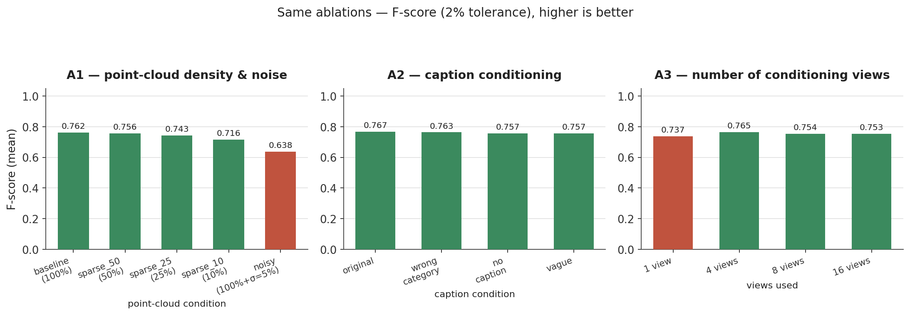

# A — ShapeR input ablations

Full data: [`results/A_input_ablations.json`](../results/A_input_ablations.json) · Code:
[`code/experiments/`](../code/experiments/) · Charts: `assets/figures/A_input_ablations_*.png`

## Question and hypothesis

ShapeR conditions on three input streams per object: a semi-dense SLAM point cloud, multiview
images, and a text caption. If reconstruction quality is dominated by one stream, the other
streams should be able to degrade substantially without much quality loss — and that matters
directly for deployment, since point density, caption quality, and view count are exactly the
things a robotic pipeline cannot guarantee. Hypothesis going in: point-cloud quality dominates,
so image/text perturbations will move quality less than point-cloud perturbations of comparable
severity.

## Baseline and modifications

Baseline: released ShapeR inference (`infer_shape.py`) on the untouched dataset pkl, unmodified
checkpoint. Three independent single-factor ablations, each sweeping one input stream and holding
the other two at the dataset default:

- **A1 — point-cloud density & noise** (`experiments/exp1_pointcloud_degradation/prepare_data.py`):
  random subsample to 50/25/10% of points, or add Gaussian noise (σ = 5% of the object's metric
  extent) at 100% density.
- **A2 — caption conditioning** (`experiments/exp2_caption_ablation/`): swap the dataset caption
  for a wrong-category label, a deliberately vague description, or an empty string.
- **A3 — conditioning view count** (`experiments/exp3_viewcount_ablation/`): restrict the view
  selector to 1, 4, 8, or 16 views (16 ≈ all views for most objects in this set).

## Inputs, sample counts, splits

All three ablations run on the **same full 178-object ShapeR test set**, one draw per condition
(no train/test split involved — this is inference-only robustness testing, not training). An
earlier quick-subset run exists (`outputs1/`) and is superseded by the full-set run
(`outputs_full/`) reported here.

## Variables changed vs held fixed

| | A1 | A2 | A3 |
|---|---|---|---|
| changed | point density / noise | caption text | number of views |
| held fixed | caption, view count, checkpoint, seed-per-object | point cloud, view count, checkpoint | point cloud, caption, checkpoint |

## Configuration and commands

See [setup-and-reproduction.md](setup-and-reproduction.md#running-each-study) for exact commands.
No training involved; inference-only, default ShapeR sampler settings.

## Metrics, units, thresholds

Chamfer distance (mean over the object, lower is better) and F-score at a 2% tolerance (fraction
of surface points matched within tolerance, higher is better), both from ShapeR's own
`evaluation/eval.py` protocol.

## Results

| condition | Chamfer (↓) | F-score (↑) |
|---|---|---|
| A1 baseline (100% pts) | 0.0212 | 0.762 |
| A1 sparse_50 | 0.0224 | 0.756 |
| A1 sparse_25 | 0.0234 | 0.743 |
| A1 sparse_10 | 0.0260 | 0.716 |
| A1 **noisy** (σ=5%) | **0.0295** | **0.638** |
| A2 original caption | 0.0214 | 0.767 |
| A2 wrong-category caption | 0.0220 | 0.763 |
| A2 no caption | 0.0218 | 0.757 |
| A2 vague caption | 0.0221 | 0.757 |
| A3 1 view | 0.0242 | 0.737 |
| A3 4 views | 0.0226 | 0.765 |
| A3 8 views | 0.0223 | 0.754 |
| A3 16 views | 0.0222 | 0.753 |

## Interpretation

- **Positional noise is the single worst input corruption tested** — worse than dropping 90% of
  the points. A sparsified-but-clean cloud (`sparse_10`) still beats a full-density noisy one on
  both metrics.
- **Caption content barely matters.** Original, a flatly wrong category label, no caption at all,
  and a deliberately vague caption land within ~3% of each other on both metrics. This is
  consistent with the point cloud dominating conditioning (see B and D for the same pattern on
  the image/mask side).
- **View count saturates fast.** Nearly all of the 1→16-view gain is captured by 4 views; 8→16
  is flat to within noise. This view count (8) is also what the mask-guided training in B uses by
  default.

## Limitations

- Single draw per condition — ShapeR's flow-matching sampler is unseeded by default, and a
  separate measurement (see [provenance.md](provenance.md)) found run-to-run Chamfer spread of
  ~23% of the mean on a single object. A2's ~3% spread and A3's 8-vs-16-view gap should be read
  as *consistent with* no real difference, not as confirmed nulls; A1's noise-vs-baseline gap
  (~39% relative) and A3's 1-vs-4-view gap are large enough to likely survive that floor, but
  neither was formally repeated across seeds here.
- A1/A2 vary one factor at a time; compounding degradations (e.g. sparse *and* noisy *and* vague)
  were not tested.
