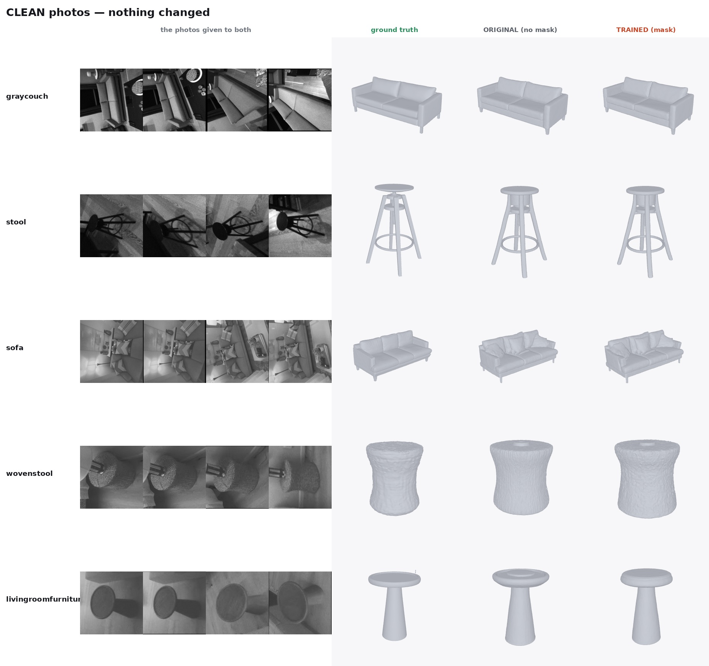

# B — SAM2-based mask conditioning

Full data: [`results/B_mask_conditioning.json`](../results/B_mask_conditioning.json) · Code:
[`code/updated_shapeR/mask_guided/`](../code/updated_shapeR/mask_guided/),
[`code/root/mask_conditioning.py`](../code/root/mask_conditioning.py) · Figure:
`assets/figures/B_comparison_clean.jpg`

## Question and hypothesis

ShapeR's image branch gets no explicit signal about which pixels belong to the target object
versus background/clutter. Hypothesis: giving the model a target foreground mask — extracted with
**SAM2** (Meta's promptable segmentation model, used unmodified here as a frozen tool, not
retrained) — as an extra conditioning channel should reduce reconstruction of non-target geometry,
especially under occlusion or clutter.

## Baseline and modifications

Baseline: released ShapeR checkpoint, unmodified (`ShapeRDenoiser`). Modification —
`MaskGuidedDenoiser` subclasses it with two small, additive changes, backbone fully frozen:

- **Option A — mask channel.** `dino_ray_extractor._mask_patch_embed[0].proj_in`, originally
  `Conv2d(1, C, 3)`, is widened to `Conv2d(2, C, 3)`: the new channel carries a per-view SAM2
  foreground mask (target points as positive clicks) alongside the existing input.
- **Option B — attention bias.** A single learnable scalar, `fg_bias_scale` (zero-initialised),
  scales a foreground-mask-derived bias added inside the model's attention.

**305 trainable parameters total**, everything else frozen. This is the entirety of "my
lightweight conditioning modification" referenced in the thesis — it is additive to the released
ShapeR architecture, not a retrain or architecture redesign.

## Inputs, sample counts, splits

- **Train**: 18 diverse objects with ground-truth meshes, explicitly excluding every stool
  object (`updated_shapeR/train_mask_guided.slurm`).
- **Held-out test**: 5 objects (stool, graycouch, sofa, livingroomfurniture, wovenstool) —
  disjoint from train by construction (asserted in the test script), deliberately including the
  excluded stool category so held-out performance isn't inflated by category overlap.

## Variables changed vs held fixed

Changed: the two conditioning additions above, trained. Held fixed: base checkpoint weights
(frozen), dataset, view count (8), seed-per-eval-cell in the multi-seed pass.

## Configuration and verified commands

```bash
python updated_shapeR/mask_guided/train.py \
    --data_pkls <18 train pkls> --num_views 8 --epochs 20 --lr 1e-3
```
AdamW, `facebook/sam2.1-hiera-base-plus` for mask extraction, ~22 min wall time on one GPU.
`fg_bias_scale` converges to ≈0.10. Full command set and environment:
[setup-and-reproduction.md](setup-and-reproduction.md).

## Metrics, units, thresholds

Extra% (held-out-eval): fraction of predicted surface with no matching ground-truth surface
within tolerance — lower is better, no fixed significance threshold; the multi-seed pass below
uses paired bootstrap 95% CIs instead.

## Results

### Single-seed held-out Extra%, baseline → masked

| object | baseline | masked |
|---|---|---|
| stool | 15.1 | **9.9** (only clear win) |
| graycouch | 2.1 | 2.7 |
| sofa | 20.9 | 21.1 |
| livingroomfurniture | 28.8 | 55.2 |
| wovenstool | 55.5 | 55.9 |
| **mean** | 24.5 | 28.9 (worse) |

### Multi-seed verdict (the number that should be quoted)

Paired design: 5 held-out objects × occlusion {0%, 60%} × 3 seeds = 30 paired cells, both models
sharing views/masks/noise per cell.

**Mask guidance is NOT better than vanilla ShapeR.** No metric at any occlusion level has a
bootstrap 95% CI excluding zero. The single-seed hint that guidance loses less surface under
occlusion (Missing% degradation +1.6 vs +3.7) did not survive: at 3 seeds it is −2.38 vs −0.36,
paired diff −2.02, CI [−5.83, +1.09].



## Interpretation

The failure mode is not "the mask is wrong" — a follow-up test in [D](D-depth-verified-masks.md)
gave the fine-tune a *perfect*, ground-truth depth-verified mask instead of SAM2's guess, and it
still barely moved the outcome. The conditioning channel itself is too weak for the frozen
backbone to act on, consistent with A's finding that the text/caption channel is similarly inert
— ShapeR's geometry is carried overwhelmingly by the semi-dense point branch.

## Limitations

- The 305-parameter, frozen-backbone design was a deliberate "lightweight, no retraining of the
  core model" choice; it cannot rule out that a larger, unfrozen fine-tune would use the mask
  channel better (a separate LoRA attempt on the point/image fusion attention was tried and did
  not converge — out of scope for this repository, not one of the four sections requested).
- The single-seed held-out table and the specific multi-seed bootstrap CIs above are carried over
  from a prior analysis pass rather than re-read from a live results file in this documentation
  pass — see [provenance.md](provenance.md) for exactly what was and wasn't re-verified.
