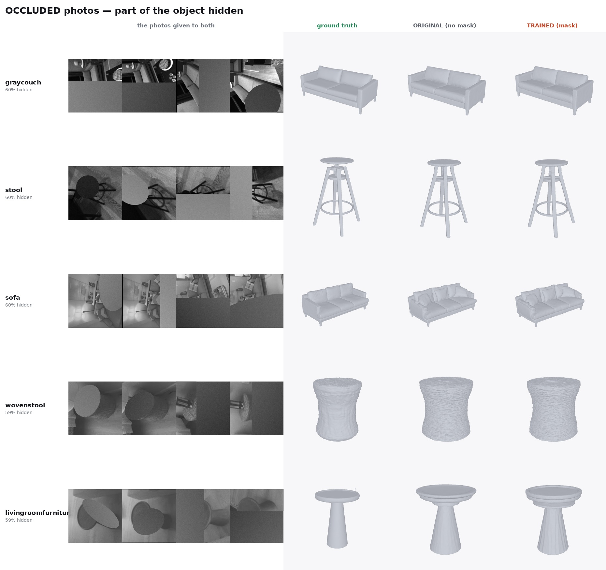
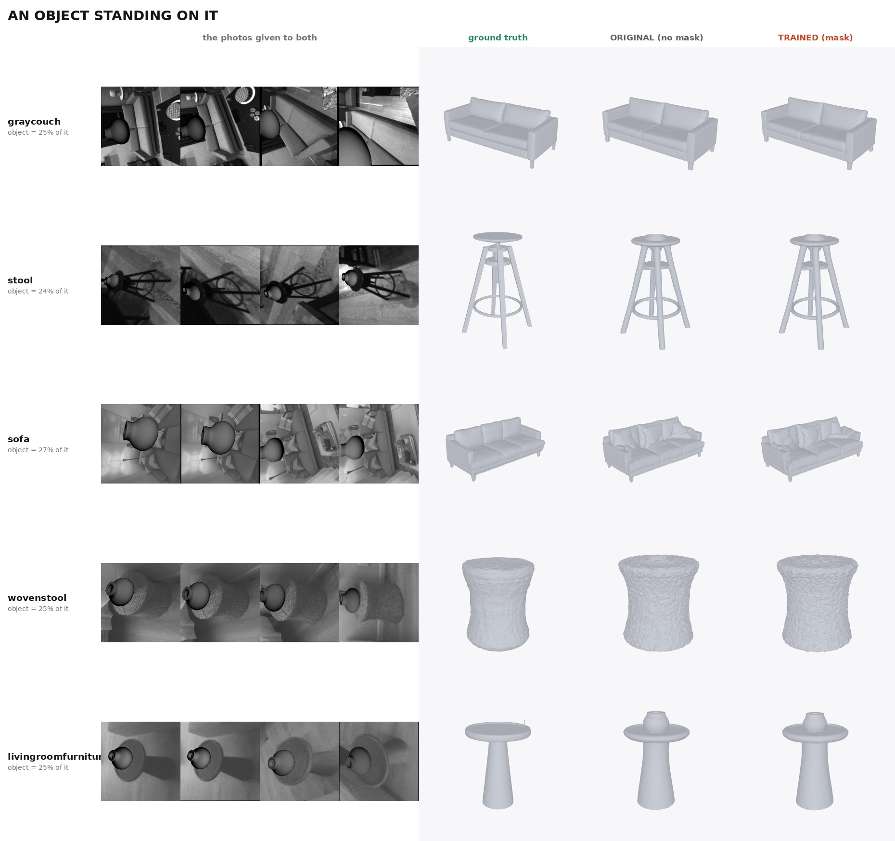
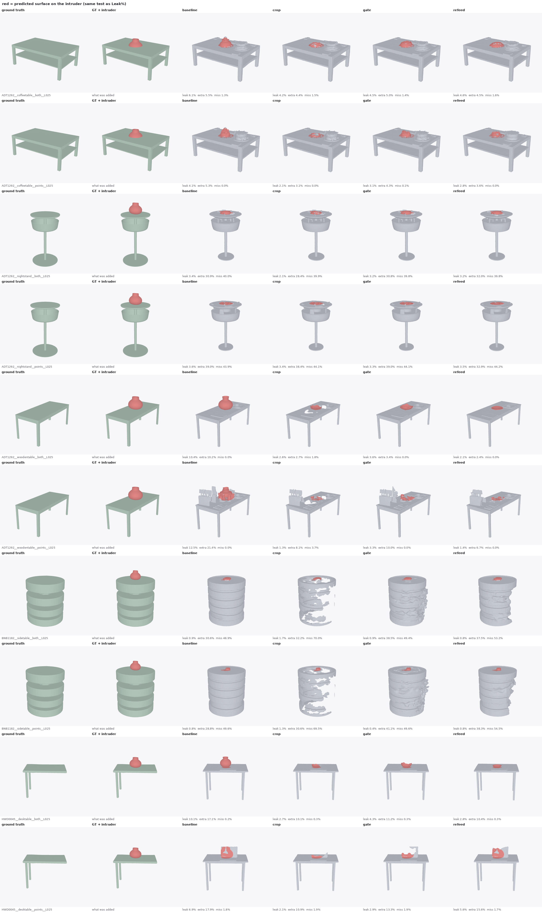
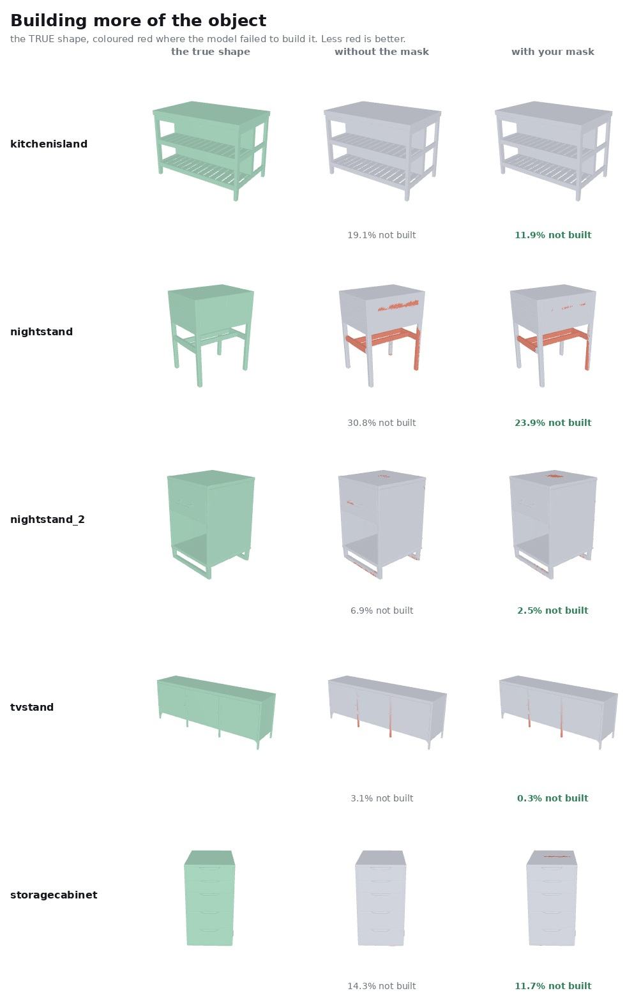

# C — Occlusion and clutter

Full data: [`results/C_occlusion_and_clutter.json`](../results/C_occlusion_and_clutter.json) ·
Code: [`code/updated_shapeR/testing/`](../code/updated_shapeR/testing/),
[`code/updated_2/`](../code/updated_2/) · Source write-up this page is built from:
[`code/updated_2/README.md`](../code/updated_2/README.md) (the user's own, read and transcribed,
not re-derived) · Figures: `assets/figures/C_*`

## Question and hypothesis

ShapeR's own paper (Appendix D, Fig. 15b) reports a limitation: when objects have other items
stacked or closely attached, reconstructed meshes sometimes include remnants of the adjacent
structure — **even when that structure's points are not in the input.** This section tests that
limitation directly, separates *which conditioning channel* leakage enters through, and attempts
a mitigation.

## C1 — Image occlusion, points intact

**Setup.** A grey bar/blob occluder is painted into every photo at a measured fraction; SLAM
points that fall behind it are dropped. Ground-truth mesh, cameras, crop box, and caption are
untouched. ORIGINAL ShapeR vs the mask-guided fine-tune ([B](B-mask-conditioning.md)) run on
identical images/masks/seeds.

**Result.** No consistent occlusion advantage for mask guidance; see
[B](B-mask-conditioning.md)'s multi-seed verdict — the same paired run covers both occlusion and
mask conditioning.

## C2 — Synthetic clutter, images only

**Setup.** A real 3D distractor mesh (e.g. a plant pot) is rendered multiview-consistently beside
the target and composited into the photos only — the SLAM point cloud carries zero knowledge of
it (`updated_2/clutter.py`, mode=`image`).

**Result.** Under the original Extra% metric, no measurable leakage was found at distractor sizes
13–49% of the target's projected area. That read was **partly a metric artifact**: once Leak%
(C3) existed, re-scoring showed Extra% moving −0.1 on `woodentable`'s image-mode cell while Leak%
rose +7.8 — leaked geometry was displacing ordinary fidelity error inside the same Extra% number,
masking it. The image branch does leak, on the objects ShapeR otherwise reconstructs well.

## C3 — Synthetic clutter, images and point cloud

**Setup.** `clutter.py` stands a real object on the target's own support surface and writes it
into both conditioning branches via exact ray-cast visibility per view. Three modes isolate the
channel: `image` (distractor in photos only), `points` (distractor in SLAM points only), `both`
(in both). 5 objects × 3 seeds, paired bootstrap 95% CI.

**Dose-response, mode=`both`, level 0.25:**

| level | ΔLeak | 95% CI | significant |
|---|---|---|---|
| 0.15 | +1.2 | [+0.7, +1.9] | yes |
| 0.25 | +4.2 | [+2.5, +5.8] | yes |
| 0.40 | +11.8 | [+6.8, +17.1] | yes |

Clean monotonic dose-response. At 0.15, ΔLeak is significant while ΔExtra is *negative* and not
significant — the standard metric points the wrong way at small intruder sizes, which is why
Leak% (scored against the exact placed distractor mesh, see [provenance.md](provenance.md)) had
to be built.

**Per-object ΔLeak at level 0.25, by mode:**

| object | both | points | image |
|---|---|---|---|
| woodentable | +8.3 | +9.2 | **+7.8** |
| desktable | +7.3 | +2.5 | −0.1 |
| coffeetable | +4.2 | +2.2 | −0.1 |
| nightstand | +1.0 | +1.1 | +0.0 |
| sidetable | +0.1 | +0.1 | −0.3 |

**Leakage tracks clean reconstruction quality, not the clutter alone.** Ranking objects by their
*clean* Missing% reproduces the leakage ranking exactly. Where ShapeR already fails to build the
clean object (`sidetable`: 53.6% clean Missing%), it fails to build the intruder too — a
different limitation (low image fidelity / too few views), out of this scope, and reported
separately rather than pooled, since averaging it in would dilute the real effect toward zero.

## C4 — Target completeness and neighbouring-object leakage: mitigation attempt

Selection rule for "affected" objects (ΔLeak ≥ 2.0 at Stage 1) was **pre-declared before Stage 2
ran**, and depends only on the baseline model.

**Affected objects (18 paired runs: woodentable, coffeetable, desktable × both/points × 3 seeds):**

| method | ΔLeak | ΔMissing (damage) |
|---|---|---|
| crop (delete unsupported mesh surface) | −5.82 [−7.3,−4.3] | **+0.97 [+0.4,+1.7]** |
| gate (drop intruder latent tokens) | −3.97 [−5.3,−2.7] | +0.02 (ns) |
| **refeed** (gate, then re-denoise) | **−5.16 [−6.9,−3.5]** | **−0.01 (ns)** |

`refeed` removes as much leakage as cropping, with damage statistically indistinguishable from
zero.

**Unaffected objects — the harm check, and it fails (12 paired runs):** every method still
degrades reconstruction somewhat on objects with no real leakage (crop: ΔMissing +10.06; gate:
+0.91; refeed: +2.91) — the main obstacle to deploying any of these methods unconditionally.

### Generalisation follow-up — NEGATIVE

A pre-registered confirmation on **14 fresh table-like objects** (mode=`both`, level 0.25, 3
seeds, abstention threshold frozen in advance):

- `refeed`'s leak removal on these 14 is a fifth of what it was on the original 5 (ΔLeak −1.03 vs
  −5.16) **and** causes real new damage (ΔMissing +5.95 vs −0.01). **The Stage 2/3 headline does
  not generalise as originally stated.**
- The underlying mechanism (order damage risk by point-cloud health / recall) still works — every
  harmful object scored below the threshold — but the specific threshold value (0.95, tuned on
  the original 5) does not transfer; the true boundary on the 14 sits near 0.984. That number is
  explicitly **not adopted** without a third, independent confirmation set — see
  [`code/updated_2/confirm/RESULT.md`](../code/updated_2/confirm/RESULT.md).

## Limitations

- C2's specific numeric result (no leakage under Extra%) could not be re-verified from a live
  file in this pass; its source folder is reported gone from the working VM. It is retained
  because `updated_2/README.md` itself names and corrects it.
- Leak%/Extra%/Missing% are all scored against the **pseudo-ground-truth mesh** shipped with the
  dataset, except the distractor-specific Leak% term, which is scored against the exact placed
  distractor mesh (a genuinely measured quantity, not an estimate) — see
  [provenance.md](provenance.md) for the full pseudo-GT-vs-measured breakdown.
- The mitigation (C4) is shown to not generalise past its original 5-object demonstration set at
  a fixed threshold; it is reported here as a negative/cautionary result, not a solved method.
