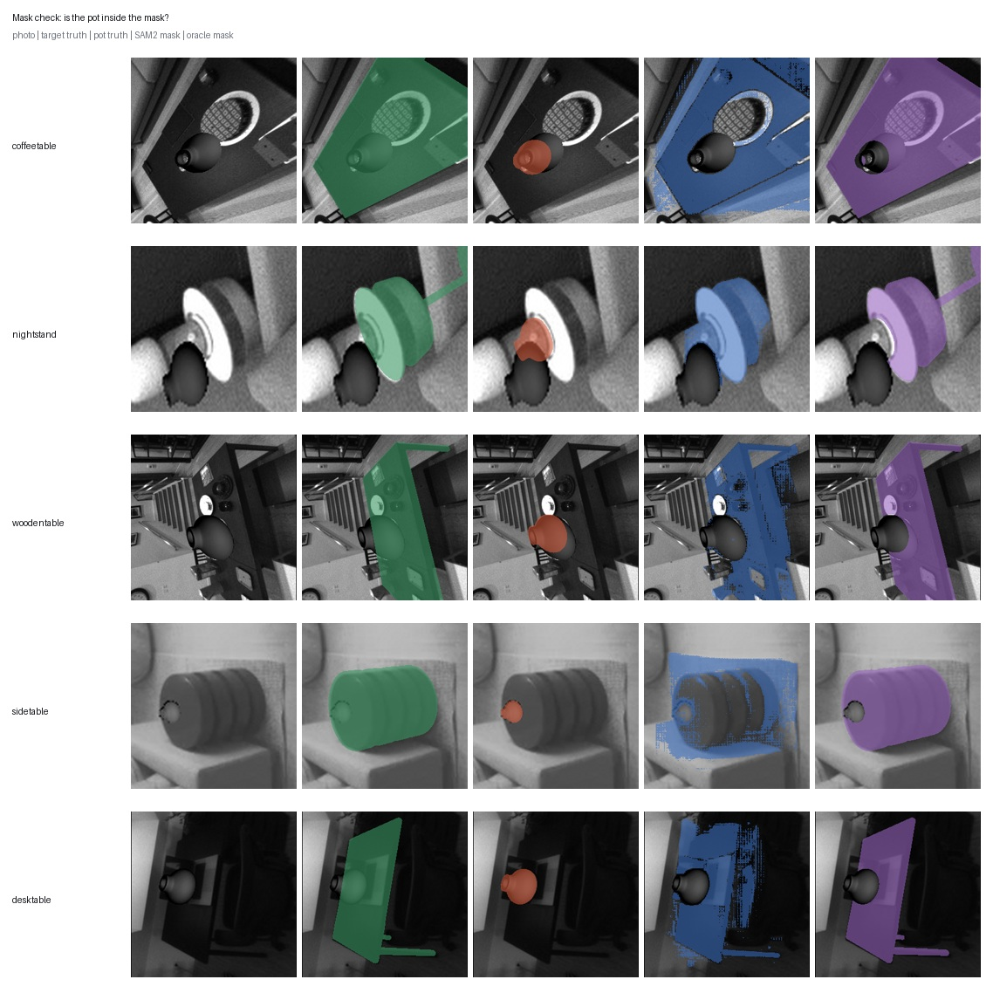
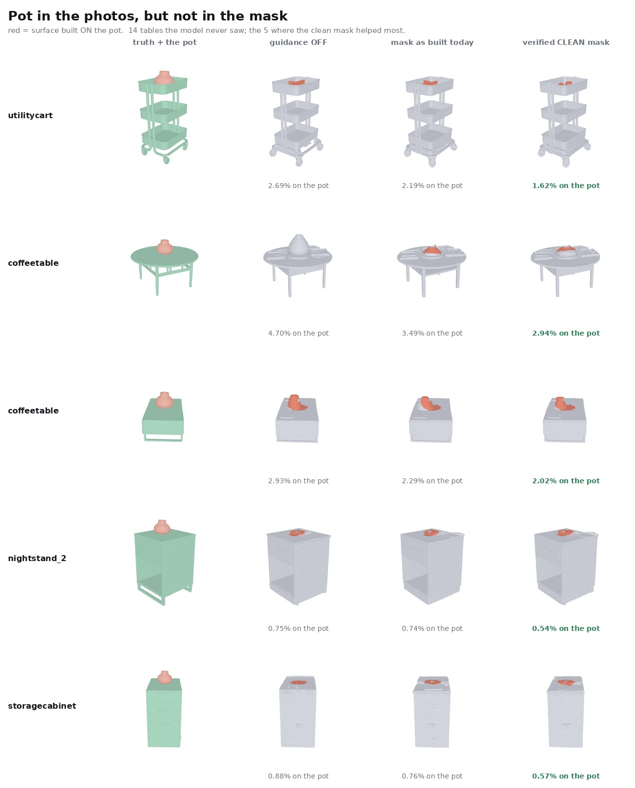
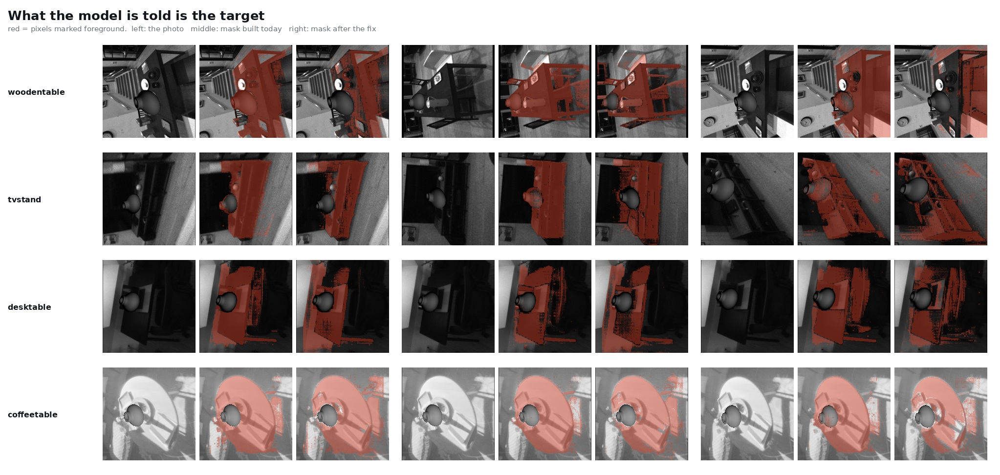
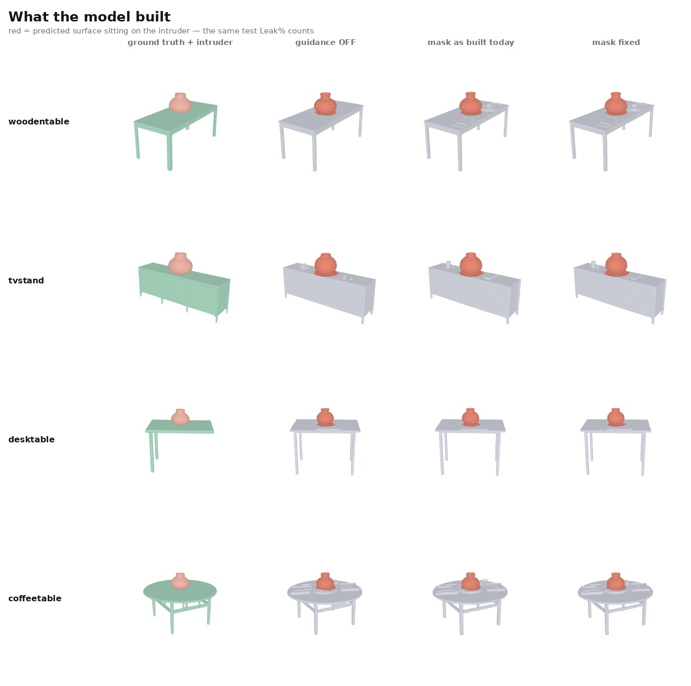

# D — Depth-verified masks

Full data: [`results/D_depth_verified_masks.json`](../results/D_depth_verified_masks.json) · Code:
[`code/updated_2/mask_vs_leak/`](../code/updated_2/mask_vs_leak/) · Figures: `assets/figures/D_*`

## Question and hypothesis

[B](B-mask-conditioning.md) found mask guidance does not help, even though SAM2 masks look
reasonable by eye. Two explanations are possible: the mask conditioning *channel* is too weak to
matter, or the *masks themselves* are wrong (SAM2 including the distractor as foreground, which
would tell the model to reconstruct exactly what it should suppress). This section separates
them by constructing a **mask that is provably correct** and re-running the same comparison.

Depth here is **rendered on the fly** from the ground-truth and distractor meshes through the
dataset's own cameras — ShapeR's pkl schema has no stored depth channel at all (confirmed by
direct inspection, see [provenance.md](provenance.md)), so this is not a feature the dataset
provides; it's a verification step built for this experiment specifically.

## Baseline and modifications

- **Mask filtering procedure** (`oracle_mask.py`'s `oracle_masks()`): render the ground-truth
  target mesh's depth *and* the distractor mesh's depth through the same batch cameras, then
  remove mask pixels wherever the distractor is nearer the camera than the target — a real
  per-pixel depth test, not a silhouette or heuristic.
- **Bug caught before trusting any result from it**: the first version (silhouette only, no depth
  test) covered 76–100% of the distractor's own pixels, because the distractor physically stands
  in front of the target in these scenes. That "oracle" mask would have told the model exactly
  where the distractor was — the opposite of its purpose. Caught by `verify_masks.py` scoring the
  mask against rendered ground-truth silhouettes before using it anywhere downstream.
- **Target retention / distractor removal, alternative method** (`clean_masks.py`'s
  `masks_with_negatives()`): a non-depth comparison point — split the point cloud with a support
  segmenter, then prompt SAM2 with target points as positive clicks and intruder points as
  negative clicks.

## Inputs, sample counts, splits

- Depth-verified vs SAM2 comparison: 41 object×seed pairs, `image`-mode clutter (distractor in
  photos only, absent from the point cloud — the one condition where the mask channel could
  possibly matter, since the point branch has zero other signal about the distractor).
- Support-segmenter comparison: 24 object×seed pairs, mixed clutter modes.

## Variables changed vs held fixed

Three arms per comparison share the object, the clutter, the views, and the generation seed —
only the mask differs. Arm definitions:

| arm (depth comparison) | mask used |
|---|---|
| `off` | guidance disabled |
| `sam2` | today's pipeline mask (SAM2 click-prompted from SLAM projections) |
| `oracle` | depth-verified mask, distractor excluded by construction |

| arm (segmenter comparison) | mask used |
|---|---|
| `control` | guidance disabled |
| `stock` | today's pipeline mask |
| `fixed` | support-segmenter + SAM2 positive/negative clicks |

## Metrics, units, thresholds

Leak% (predicted surface sitting on the known, exactly-placed distractor mesh — a measured
quantity, not pseudo-GT), alongside Extra% and Missing% for context.

## Results

| arm | Leak% | Extra% | Missing% |
|---|---|---|---|
| off | 2.345 | 19.947 | 14.360 |
| sam2 (today's mask) | 2.023 | 20.746 | 11.778 |
| **oracle (depth-verified)** | **1.913** | 20.009 | 11.490 |

| arm | Leak% | Extra% | Missing% |
|---|---|---|---|
| control | 8.305 | 17.190 | 13.457 |
| stock | 8.292 | 18.049 | 11.373 |
| fixed (support segmenter) | 8.146 | 17.472 | 10.909 |

## Interpretation

Even a **perfect, ground-truth** depth-verified mask only beats SAM2's own guess by ~0.11 points
of Leak% (1.913 vs 2.023) — nowhere close to eliminating the leakage present without any
guidance (2.345). The support-segmenter fix shows the identical small, inconclusive pattern. This
answers the question posed above directly: **mask accuracy is not the bottleneck.** The model's
mask-conditioning channel is too weak to act decisively on an accurate mask even when handed one,
consistent with [B](B-mask-conditioning.md)'s null multi-seed verdict and [A](A-input-ablations.md)'s
finding that the caption channel is similarly inert — the point branch dominates.

## Limitations

- None of these deltas were run through a paired bootstrap CI (unlike B and C); they are reported
  as sample means over 41 / 24 object×seed pairs, not as statistically confirmed differences.
  Given their size relative to B's null result at 30 paired cells, they should be read as
  consistent with "no real effect," not as a confirmed small positive effect.
- The depth-verified comparison is run in `image`-mode clutter specifically, the one condition
  designed to isolate the mask channel; it does not speak to `points`- or `both`-mode clutter,
  where the point branch already sees the distractor directly (see
  [C](C-occlusion-and-clutter.md)).
